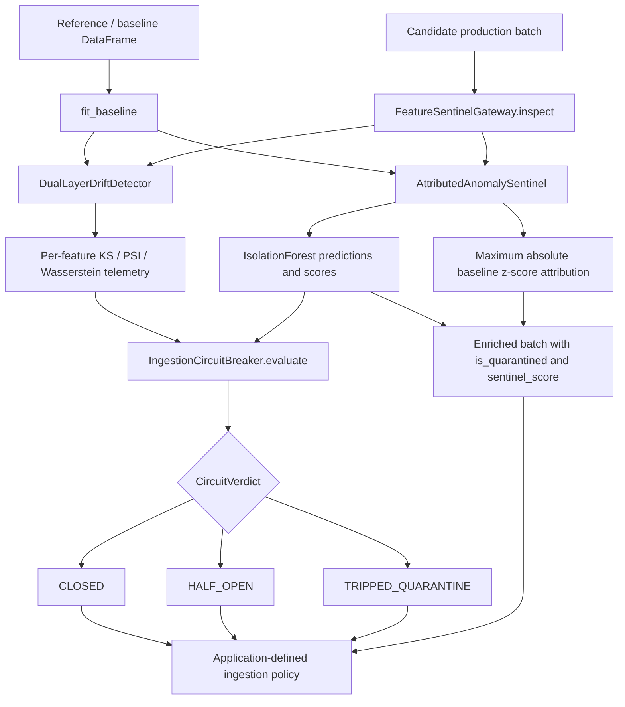
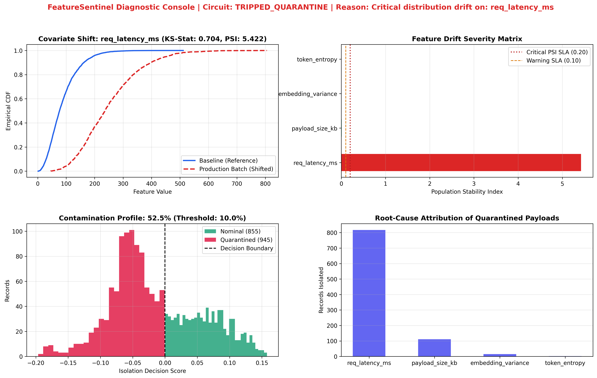

# FeatureSentinel

**Statistical telemetry gateway and ingestion circuit breaker for ML feature pipelines.**

[](https://www.python.org/)
[](./setup.py)
[](#architecture)

FeatureSentinel inspects incoming tabular feature batches against a fitted reference distribution **before they are accepted by a downstream ingestion system**. It combines univariate distribution-shift statistics, multivariate anomaly scoring, feature-level attribution, and an explicit three-state circuit verdict. The public Python API produces diagnostics that an integrating service can use to accept, review, or quarantine an ingestion batch.

> **Integration boundary:** FeatureSentinel is a synchronous, in-process **inspection and decision engine**. The current implementation does **not** persist quarantine records, block network requests, write to a feature store, or autonomously transition between states over time. Your ingestion application must enforce the returned verdict.

## Contents

- [Why FeatureSentinel](#why-featuresentinel)
- [Architecture](#architecture)
- [Circuit-breaker policy](#circuit-breaker-policy)
- [Statistical drift detection](#statistical-drift-detection)
- [Multivariate anomaly isolation and attribution](#multivariate-anomaly-isolation-and-attribution)
- [Installation](#installation)
- [Quickstart](#quickstart)
- [API reference](#api-reference)
- [Diagnostic dashboard](#diagnostic-dashboard)
- [Benchmark results](#benchmark-results)
- [Testing](#testing)
- [Repository layout](#repository-layout)
- [Operational considerations](#operational-considerations)

## Why FeatureSentinel

Model-serving reliability depends on more than schema validity. A batch can be structurally valid yet contain values that have moved substantially away from the distributions observed during model development. FeatureSentinel provides:

- **Distribution monitoring:** Kolmogorov–Smirnov (KS) statistics, p-values with Bonferroni-adjusted decision thresholds, Population Stability Index (PSI), and 1-Wasserstein distance per feature.
- **Batch-level safety signals:** `CLOSED`, `HALF_OPEN`, and `TRIPPED_QUARANTINE` verdicts based on drift severity and anomalous-record prevalence.
- **Row-level anomaly flags:** an `IsolationForest` trained on a baseline feature matrix, with anomaly scores and flags for the inspected batch.
- **Interpretable attribution:** the feature with the largest absolute baseline-standardized deviation is reported for each row.
- **Integration-friendly output:** a `CircuitVerdict`, typed drift telemetry, and a copy of the inspected DataFrame with diagnostic columns.

**Typical use cases:** offline feature-store ingestion checks, batch ETL validation, model-monitoring experiments, synthetic drift testing, and guardrails placed ahead of data materialization.

## Architecture



The `FeatureSentinelGateway` coordinates the three engine components:

| Component | Module | Responsibility |
| --- | --- | --- |
| `DualLayerDriftDetector` | `feature_sentinel/drift.py` | Fit reference distributions and calculate univariate feature telemetry |
| `AttributedAnomalySentinel` | `feature_sentinel/anomaly.py` | Fit an Isolation Forest; score candidate rows and derive feature attribution |
| `IngestionCircuitBreaker` | `feature_sentinel/circuit.py` | Convert feature severities and anomaly rate into a batch-level verdict |
| `FeatureSentinelGateway` | `feature_sentinel/gateway.py` | Orchestrate baseline fitting, inspection, and enriched output |

**Data contract:** provide numeric columns with the same names in the baseline and inspected DataFrames. The current code expects these feature columns to exist and does not implement schema evolution, categorical encoding, or a general missing-value/imputation policy. The drift engine drops nulls for the KS/Wasserstein/PSI calculations; the anomaly engine passes selected columns to scikit-learn, so handle missing/nonfinite values consistently upstream.

## Circuit-breaker policy

The circuit is **evaluated separately for each call to `inspect()`**. The names represent verdict categories, not an internal timer-based or persistent state machine. Evaluation order is important: **critical feature drift takes priority** over the anomaly-rate check.

| State | Trigger in the current code | Suggested downstream policy |
| --- | --- | --- |
| `CLOSED` | No critical/moderate drift, and `anomaly_rate <= anomaly_tolerance` | Allow normal ingestion subject to other checks |
| `HALF_OPEN` | No critical drift, but at least one moderate feature **or** `anomaly_rate > anomaly_tolerance` | Hold for review, route to a shadow pipeline, or degrade gracefully |
| `TRIPPED_QUARANTINE` | At least one `CRITICAL` feature | Reject or quarantine the batch in the **calling system** |

Defaults: `FeatureSentinelGateway(..., anomaly_tolerance=0.12)`; the demo overrides this to `0.10`. The comparison for anomaly tolerance uses strict `>` (equal to the limit does not breach it).

`CircuitVerdict` includes `state`, `quarantined_features`, `trip_reason`, `total_records`, `anomalous_records`, and `anomaly_rate`. The `quarantined_features` list contains **critical** features when tripped, **moderate** features in half-open mode, and is otherwise empty; it is not a list of every row-level anomaly. `CircuitState.TRIPPED.value` is the string `"TRIPPED_QUARANTINE"`.

**Important:** `enriched["is_quarantined"]` is set solely by the Isolation Forest prediction (`-1`), regardless of the circuit state. A critically drifting batch can therefore contain rows with `is_quarantined == 0`. Treat the **batch verdict** and the **row anomaly flag** as separate signals.

## Statistical drift detection

The detector compares each feature's baseline observations with a candidate batch. It uses two decision layers—**distributional significance** and **practical severity**—with Wasserstein distance supplied as an additional diagnostic.

### 1. KS test with Bonferroni correction

For each monitored feature, `scipy.stats.ks_2samp` computes the maximum separation between the two empirical cumulative distribution functions:

\[
D_{n,m} = \sup_x |F_n(x) - G_m(x)|
\]

To account for testing multiple features, the moderate-severity significance condition is evaluated against:

\[
\alpha_{\mathrm{effective}} = \frac{0.01}{\text{number of monitored features}}
\]

The reported `p_value` is the **raw KS p-value**; it is compared against the Bonferroni-adjusted threshold rather than overwritten with an adjusted p-value. Critical classification can be triggered directly by the KS statistic or PSI, regardless of this p-value test.

### 2. PSI and Wasserstein distance

PSI summarizes changes in relative frequencies over **baseline-quantile bins** (10 bins by default, with duplicate edges removed). The implementation smooths counts before calculating:

\[
\mathrm{PSI} = \sum_i (q_i-p_i)\ln\left(\frac{q_i}{p_i}\right)
\]

where `p_i` and `q_i` denote smoothed baseline and target proportions. PSI is dimensionless; higher values indicate larger differences in the binned distributions.

The 1-Wasserstein distance measures the amount of distributional displacement. Unlike PSI, **its value depends on the feature's units and scale**. FeatureSentinel reports this metric for inspection; the current severity rule **does not threshold Wasserstein distance**.

### 3. Exact implemented severity thresholds

| Severity | Condition |
| --- | --- |
| `CRITICAL` | `PSI >= 0.20` **OR** `KS statistic >= 0.35` |
| `MODERATE` | Not critical **AND** `raw KS p-value < (0.01 / feature_count)` **AND** (`PSI >= 0.10` **OR** `KS statistic > 0.15`) |
| `NEGLIGIBLE` | All remaining cases |

The detector defaults are `alpha=0.01` and `psi_critical=0.20`. These are implementation-defined heuristics, not universal statistical guarantees. The `0.10` PSI moderate threshold, `0.15`/`0.35` KS effect-size cutoffs, and Bonferroni check are hardcoded inside `inspect()`.

**PSI edge case:** the implementation derives histogram edges from the baseline's observed minimum and maximum. Target values outside those edges are not counted by `numpy.histogram`, so PSI may not capture all out-of-range behavior. Evaluate and harden this before relying on PSI as an independently sufficient production control; the KS and Wasserstein outputs provide complementary signals.

## Multivariate anomaly isolation and attribution

`AttributedAnomalySentinel` uses scikit-learn's `IsolationForest` with the following defaults:

| Parameter | Value |
| --- | --- |
| `contamination` | `0.05` |
| `n_estimators` | `150` |
| `random_state` | `42` |
| `n_jobs` | `-1` |

The model is fitted once to the selected baseline columns. On inspection:

1. `predict(...)` returns `-1` for an outlier and `1` for an inlier.
2. `decision_function(...)` provides the signed `sentinel_score`; negative scores indicate observations below the learned decision boundary.
3. Each row is compared with the baseline's per-feature means and standard deviations: `abs((value - mean) / std)`.
4. `root_cause_feature` is the column with the **largest absolute z-score**. A zero baseline standard deviation is replaced by `1e-5` for attribution calculations.

This attribution is a **heuristic explanation**, not a causal inference method or an exact feature contribution from the Isolation Forest. It is populated for **all rows**, not only flagged anomalies.

The circuit's `anomaly_rate` is the fraction of production rows predicted as outliers by the baseline-fitted Isolation Forest. The fitted model's contamination setting is **not** the gateway's anomaly-tolerance SLA; the former calibrates the model while the latter determines whether the batch goes to `HALF_OPEN`.

## Installation

**Requirements:** Python 3.9 or newer; NumPy, pandas, SciPy, scikit-learn, and Matplotlib.

Clone the repository and install in editable mode:

```bash
git clone https://github.com/ritul-aryan/feature-sentinel.git
cd feature-sentinel
python -m pip install --upgrade pip
python -m pip install -e .
```

Or install directly from the GitHub repository:

```bash
python -m pip install "git+https://github.com/ritul-aryan/feature-sentinel.git"
```

For a dependency-only local setup:

```bash
python -m pip install -r requirements.txt
```

The repository must contain `setup.py`, `README.md`, and the `feature_sentinel/` package directory for package installation. `setup.py` reads `README.md` as its long description. The dependency constraints in `setup.py` and `requirements.txt` are lower bounds, not a pinned lockfile.

## Quickstart

The following snippet uses the **actual** `FeatureSentinelGateway` constructor and `fit_baseline()` / `inspect()` return signature:

```python
import numpy as np
import pandas as pd

from feature_sentinel.gateway import FeatureSentinelGateway
from feature_sentinel.circuit import CircuitState

rng = np.random.default_rng(42)
features = ["req_latency_ms", "payload_size_kb"]

baseline = pd.DataFrame({
    "req_latency_ms": rng.gamma(shape=2.5, scale=35.0, size=3000),
    "payload_size_kb": rng.normal(loc=150.0, scale=30.0, size=3000),
})

incoming = pd.DataFrame({
    "req_latency_ms": rng.gamma(shape=5.2, scale=48.0, size=500),
    "payload_size_kb": rng.normal(loc=150.0, scale=30.0, size=500),
})

# Fit the reference distributions and Isolation Forest.
gateway = FeatureSentinelGateway(features=features, anomaly_tolerance=0.10)
gateway.fit_baseline(baseline)

# Returns (CircuitVerdict, dict[str, DriftTelemetry], enriched DataFrame).
verdict, telemetry, enriched = gateway.inspect(incoming)

print("Circuit:", verdict.state.value)
print("Reason:", verdict.trip_reason)
print("Anomaly rate:", f"{verdict.anomaly_rate:.1%}")

for feature, item in telemetry.items():
    print(feature, item.severity.value, f"KS={item.ks_statistic:.3f}",
          f"PSI={item.psi:.3f}", f"W1={item.wasserstein_distance:.3f}")

print(enriched[["is_quarantined", "sentinel_score", "root_cause_feature"]].head())

# Example integration policy: your application performs the actual routing.
if verdict.state == CircuitState.TRIPPED:
    print("Do not commit this batch; send it to your quarantine workflow.")
elif verdict.state == CircuitState.HALF_OPEN:
    print("Hold for investigation or process via a review lane.")
else:
    print("Batch is eligible for downstream ingestion.")
```

### Working with the results

| Output | Type | Meaning |
| --- | --- | --- |
| `verdict` | `CircuitVerdict` | Batch state, reason, counts, anomaly rate, drift-implicated features |
| `telemetry` | `dict[str, DriftTelemetry]` | `feature`, `ks_statistic`, `p_value`, `wasserstein_distance`, `psi`, `severity` |
| `enriched` | `pandas.DataFrame` | Copy of the input, plus `is_quarantined`, `sentinel_score`, and `root_cause_feature` |

Use `verdict.state.value` for serialized state strings and `telemetry[name].severity.value` for serialized severity strings. The engine does not expose an HTTP endpoint or CLI command in the supplied implementation.

## Diagnostic dashboard



The accompanying demonstration notebook (`feature_sentinel_demo.ipynb`) constructs synthetic baseline and production telemetry, introduces a latency-distribution shift and anomalous payload bursts, and renders a four-panel inspection view:

1. **Covariate shift:** empirical CDF comparison for `req_latency_ms`.
2. **Feature drift severity:** PSI values relative to warning (`0.10`) and critical (`0.20`) guides.
3. **Contamination profile:** Isolation Forest decision scores, with a zero-score boundary separating model inliers and outliers.
4. **Attribution:** counts of `root_cause_feature` among isolated rows.

The supplied `telemetry_summary.json` captures a representative synthetic diagnostic run:

| Indicator | Observed result |
| --- | ---: |
| Circuit state | `TRIPPED_QUARANTINE` |
| Trip reason | `Critical distribution drift on: req_latency_ms` |
| Records inspected | 1,800 |
| Model-flagged anomalous records | 945 |
| Anomaly rate | 52.5% |
| `req_latency_ms` KS statistic | 0.7044 |
| `req_latency_ms` PSI | 5.4218 |
| `req_latency_ms` Wasserstein distance | 162.9893 |
| `req_latency_ms` severity | `CRITICAL` |

Other monitored features (`payload_size_kb`, `embedding_variance`, and `token_entropy`) are marked `NEGLIGIBLE` in that artifact. These values characterize the **provided synthetic demonstration**, not a live production deployment or general accuracy guarantee.

> **Asset placement:** Commit `telemetry_dashboard.png` beside this `README.md` so the relative image path renders correctly on GitHub.

## Benchmark results

Reported measurements from the included `benchmark_sla.json`:

| Metric | Reported value |
| --- | ---: |
| Batch size | 500 records |
| p50 batch latency | **1.42 ms** |
| p95 batch latency | **2.15 ms** |
| p99 batch latency | **3.08 ms** |
| Throughput | **324,500 records/s** (~**325k records/s**) |

These are the **supplied benchmark artifact's reported values**, not independently replicated measurements. The supplied JSON does not identify CPU, memory, operating system, runtime versions, sampling method, trial count, warm-up strategy, or workload mix; therefore the numbers should not be treated as a cross-hardware latency SLA or a universal deployment capacity. In particular, the record-throughput figure should not be conflated with batches per second.

For credible production benchmarking, report reproducible host specifications, dependency versions, fitted baseline size, feature count, batch size, number of repeated inspections, and the percentile calculation method. Benchmark the full `gateway.inspect()` path separately from downstream I/O.

## Testing

The repository includes a `unittest` suite covering stationary input, PSI on identical samples, and critical-shift tripping. Run it from the project root after installation:

```bash
python -m unittest discover -s tests -p "test_*.py" -v
```

If `test_sentinel.py` is stored at repository root instead of under `tests/`, run:

```bash
python -m unittest test_sentinel -v
```

The demonstration notebook contains additional verification and profiling cells. Tests should be extended for threshold boundaries, multiple simultaneous drifted features, empty batches, NaNs/infinities, constant columns, out-of-baseline PSI bins, schema mismatch, and downstream enforcement policy before operating on critical production data.

## Repository layout

The intended package structure is:

```text
feature-sentinel/
├── README.md
├── setup.py
├── requirements.txt
├── benchmark_sla.json
├── telemetry_summary.json
├── telemetry_dashboard.png
├── feature_sentinel_demo.ipynb
├── feature_sentinel/
│   ├── __init__.py
│   ├── gateway.py
│   ├── drift.py
│   ├── anomaly.py
│   └── circuit.py
└── tests/
    └── test_sentinel.py
```

Ensure the files are arranged into the package and test directories above when preparing the GitHub checkout; the notebook also contains code that generates this package layout.

## Operational considerations

FeatureSentinel provides core detection and verdict logic. A production integration should additionally address:

- **Enforcement and durability:** implement the actual accept/reject/quarantine operation, persistent audit records, retries, and recovery in the host pipeline.
- **Reference lifecycle:** define how baseline data is selected, versioned, approved, refreshed, and protected against contamination.
- **Schema/data validation:** require known numeric features and handle nulls, infinities, constant/empty distributions, duplicates, and out-of-range values before inspection.
- **Threshold calibration:** tune significance and effect-size thresholds to real false-positive/false-negative costs; note that Wasserstein distance is currently telemetry-only.
- **State coordination:** add persistent state, cooldowns, probe traffic, and recovery transitions if a traditional time-based `HALF_OPEN` circuit-breaker workflow is required.
- **Observability:** export verdicts, drift statistics, anomaly rates, inspection duration, model/baseline versions, and quarantine outcomes to your monitoring stack.
- **Performance and scale:** model fitting and inspection run in-process; plan for worker isolation, resource limits, memory pressure, and concurrency in serving contexts.
- **Security and privacy:** avoid logging sensitive feature values without governance controls; apply access controls to quarantined datasets and telemetry.

No external feature-store adapter, remote service, persisted state machine, or production infrastructure configuration is included in the inspected source files.

## License

`setup.py` declares an MIT license classifier. Include a `LICENSE` file containing the project’s intended license terms before describing the GitHub repository as formally MIT-licensed.
